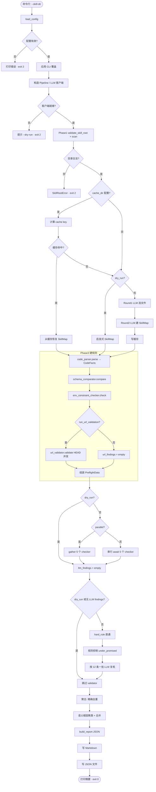

# skill-audit 当前流程（流程图素材）

> 本文档描述的是**当前代码的实际执行路径**，不是设计意图。每一项都对应到具体文件与函数；
> 如果你在图上发现某个框与实际行为不符，那就是代码该改或本文档该改。
>
> 用途：生成流程图。§10 给了一版可直接渲染的 Mermaid；§9 给了节点/边清单便于手绘或导入 draw.io。

---

## 1. 全局视图

### 1.1 入口与命令

```
python3 main.py --skill-dir <目录> [--config config.yaml] [--output x.json]
                [--dry-run] [--no-cache] [--allow-url-network] [--no-parallel]
```

| 参数 | 作用 | 代码位置 |
|---|---|---|
| `--skill-dir` | **必填**，被审计的 skill 目录 | `main.py` `parse_args` |
| `--config` | 配置文件，默认 `config.yaml` | `main.py` `parse_args` |
| `--output` | 覆盖 `report.output_path`（JSON；同名 `.md` 自动派生） | `main.py` `main()`, `core/pipeline.py` Phase 7 |
| `--dry-run` | 只跑确定性阶段，**不需要凭据、不发 LLM 请求**；默认同时关掉 URL 探测 | `main.py` `main()` |
| `--no-cache` | 不使用也不写 comprehension 缓存 | `main.py` `main()` |
| `--allow-url-network` | `--dry-run` 下仍允许 URL 探测 | `main.py` `main()` |
| `--no-parallel` | 5 个 LLM checker 串行执行 | `main.py` `main()` |

### 1.2 七个阶段 + 一个前置段

```
[main.py 前置段]  解析参数 → 载入配置 → 应用覆盖 → 构造 Pipeline（含 LLM 客户端）
        ↓
[Phase 1] Scan          校验并扫描 skill 目录
        ↓
[Phase 2] Comprehension 构建 SkillMap（缓存 / 启发式 / LLM 三选一）
        ↓
[Phase 3] Hard Checks   4 个确定性检查器（code_parser 先跑）
        ↓
[Phase 4] LLM Checkers  5 个 checker（并行 或 串行）
        ↓
[Phase 5] Validation    批量化二次校验（含规则抑制）
        ↓
[Phase 6] Aggregate     精确去重 + 语义根因聚类
        ↓
[Phase 7] Report        生成 JSON + Markdown
        ↓
[main.py 收尾]  写 JSON → 打印摘要 → 返回退出码
```

### 1.3 一句话概括每个阶段在做什么

| 阶段 | 输入 | 输出（数据结构） | 是否用 LLM |
|---|---|---|---|
| Preflight | 命令行 | `Config`、`Pipeline` | 否 |
| 1 Scan | skill 目录 | `List[FileEntry]` | 否 |
| 2 Comprehension | `List[FileEntry]` | `SkillMap` | **是**（2 轮；缓存命中或 `--dry-run` 时否） |
| 3 Hard Checks | `SkillMap` | `CodeFacts` + `List[Finding]` + `diff_summary` → 打包成 `PreflightData` | 否 |
| 4 LLM Checkers | `PreflightData` | `List[Finding]`（每个 checker 一份） | **是**（5 次） |
| 5 Validation | LLM findings + `PreflightData` | 带 `validation_status` 的 `List[Finding]` | **是**（⌈n/12⌉ 次） |
| 6 Aggregate | 硬规则 + 已校验的 LLM findings | 去重后的 `List[Finding]`（带 `root_cause_id`） | 否 |
| 7 Report | 最终 findings + `SkillMap` + token 统计 | JSON `dict` + Markdown 文本 | 否 |

---

## 2. main.py 前置段（Preflight）

| 步骤 | 动作 | 分支/失败路径 | 退出码 |
|---|---|---|---|
| M1 | `parse_args()` | — | — |
| M2 | `load_config(config_path)` | 文件不存在 → 报错 | **2** |
| M3 | 同上 | YAML 缺键/类型错 → 报错 | **2** |
| M4 | 应用 CLI 覆盖：`--output` / `--no-parallel` / `--no-cache` / `--dry-run` 关 URL | — | — |
| M5 | `Pipeline(config, dry_run=...)` | 构造 LLM 客户端失败（缺 key、provider 不支持）→ 报错并提示可用 `--dry-run` | **2** |
| M6 | `await pipeline.run(skill_dir)` | 见 §3 | — |
| M7 | 捕获 `SkillRootError` → 打印原因 | — | **2** |
| M8 | 捕获其他异常 → 打印类型与信息 | — | **1** |
| M9 | 写 JSON 报告（自动 `mkdir -p` 父目录） | — | — |
| M10 | 打印一行摘要：根因数 / critical / high / 原始条数 / 报告路径 | — | **0** |

> **关键设计点**：`SkillRootError` 单独处理并返回 2。改前传一个不存在的路径会打出
> “0 findings” 并退出 0——对一个驱动修复决策的工具，那等于把“漏报”伪装成“通过”。

---

## 3. Phase 1–7 详细流程

### Phase 1　Scan（`comprehension/scanner.py`）

```
S1  validate_skill_root(skill_dir)
      ├─ 展开 ~ 并 abspath
      ├─ 不存在            → raise SkillRootError
      ├─ 不是目录          → raise SkillRootError
      └─ rglob 找不到任何 SKILL.md → raise SkillRootError
S2  os.walk 遍历，in-place 剪枝目录：
      忽略 .git / __pycache__ / .DS_Store / node_modules / .pytest_cache /
           .mypy_cache / .ruff_cache / .venv / venv / dist / build
      忽略扩展名 .pyc / .pyo / .pyd / .so / .egg-info
S3  每个文件记录 FileEntry(path, extension, size_bytes, first_lines)
      first_lines 行数 = config.comprehension.first_lines_count（默认 3）
S4  按 path 排序（确定性顺序）
S5  结果为空 → raise SkillRootError（空目录也算不可用）
S6  打印 “N files found.”
```

### Phase 2　Comprehension（三条互斥路径）

```
C1  若 config.pipeline.cache_dir 非空：
      C1a realpath 归一化排除项：output.json、output.md、cache_dir（含子树）
      C1b key = blake2b(技能目录内所有可审计文件的内容)   ← 排除项不参与
      C1c cache_file = <cache_dir>/<key>.json
      C1d 文件存在 →
            读取并 skill_map_from_cache()
              成功 → 打印 “cache hit”，跳至 C4
              失败 → 打印 “cache unreadable; recomputing”，继续 C2
C2  若 skill_map 仍为 None 且 dry_run：
      heur = build_heuristic_map(skill_dir)         ← core/heuristic_map.py
        *.md/*.markdown/*.txt/*.rst  → description 组件（整文件）
        含 name/param/flag 表头的表格 → 追加 parameter_schema 组件
        *.py/*.js/*.mjs/*.ts/*.sh/*.bash/*.java/*.erl → implementation 组件
        含 SKILL.md 的一级子目录 → sub_skills
      打印 “Comprehension skipped (dry-run)”
C3  若 skill_map 仍为 None：
      Round 1：prompt = comprehension_round1.md + 文件清单(含前 3 行)
               → LLM → 期望 {"files_to_read":[{path,...}]}
      C3a 按返回的 path 读取文件内容（超过 max_file_size_kb 截断并标注）
      Round 2：prompt = comprehension_round2.md + 文件内容 + Round1 结论
               → LLM → components / sub_skills / sub_skill_relations / notes
      组装 SkillMap
      C3b 若配置了 cache_dir → 把 SkillMap 序列化写入 cache_file
C4  打印 “X components / Y sub-skills / Z files read”
```

**LLM 调用韧性（`comprehension/comprehension_agent.py`）**

```
_complete_with_retry(client, prompt, system, temperature, attempts=3, base_delay=2.0)
    尝试 1 失败 → sleep 2s
    尝试 2 失败 → sleep 4s
    尝试 3 失败 → raise RuntimeError("comprehension LLM call failed after 3 attempts: …")
```

**JSON 解析降级链（`_extract_json`，两个模块各有一份实现）**

```
J1 去掉 ``` 围栏 → json.loads
J2 取第一个 { 到最后一个 } → json.loads
J3 剔除控制字符 → json.loads
J4 （仅 base_checker 有）逐条正则抓 {…"taxonomy_l1"…} 重组 {"findings":[...]}
J5 全部失败 →
     comprehension：返回空壳 {files_to_read:[], components:[], …}
     base_checker ：返回 {"findings": []}
```

### Phase 3　Hard Checks（4 个确定性检查器）

**依赖顺序（不可交换）**

```
H1  code_facts = code_parser.parse(skill_map)          ← 必须先跑
H2  schema_findings, diff_summary = schema_comparator.compare(skill_map, code_facts, strict)
H3  env_findings = env_constraint_checker.check(skill_map, code_facts)   ← 同步
H4  if config.pipeline.run_url_validation:
        url_findings = await url_validator.validate(skill_map, mode=url_mode, code_urls=code_facts.http_urls)
    else:
        url_findings = []
H5  hard_findings = schema_findings + env_findings + url_findings
H6  preflight = PreflightData(skill_map, code_facts, hard_findings, diff_summary)
```

**H1　code_parser（AST）**

```
P1  对每个 implementation 组件 ast.parse
      SyntaxError → 跳过该组件（不报错）
P2  _parse_functions(tree, comp.source_file)：
      跳过 self 参数；记录 name/type/default/required/return_type/decorators/lineno/source_file
P3  _parse_raises / _parse_imports
P4  _parse_http_urls：收集 http(s) 字符串字面量，**排除 docstring 节点**
P5  _has_file_write：open(...,"w"/"wb"/"a"/"ab"/"x"/"xb") 或 write/writelines/dump/save
P6  _has_global_mutation：模块级赋值或 global 语句
P7  _main_guard_calls：收集 `if __name__ == "__main__":` 内被调用的函数名
P8  entry_function = _guess_entry_function(functions)
      ★ 只在“有参数”的函数里选；候选含 run/execute/main/invoke/call/handle/app/parse，
        否则取第一个非下划线函数；全都无参数 → None
输出 CodeFacts(functions, raises, http_urls, has_file_write, has_global_mutation,
               imports, entry_function, module_entry_calls)
```

**H2　schema_comparator**

```
SC1 取 parameter_schema 组件；没有 → 直接返回（diff 为空）
SC2 无 implementation 函数 → 返回并记录 “No implementation functions parsed”
SC3 _select_target_function()：
      a) code_facts.module_entry_calls 中第一个“有参数”的函数      → 采用
      b) 否则按“与 schema 参数名交集大小”降序，取交集 > 0 的第一个   → 采用
      c) 否则 code_facts.entry_function（须有参数）                  → 采用
      d) 否则 → 不比对，diff 记录 “could not determine which function …”
      ★ 已删除 `next(iter(code_funcs.values()))` 兜底
SC4 逐个 schema 组件：
      _extract_schema_params()
        JSON（properties / 对象数组）
        或 markdown 表：按表头映射列名，跳过 `| --- |` 行，认 name/param/parameter/flag/option/参数/选项
        表头缺失或解析不到 → 记 “Could not parse schema — LLM review needed”
SC5 若 schema 参数名与目标函数参数名**无任何交集** →
      跳过并记 “No overlapping parameter names … probable interface mismatch”
SC6 三类比对（有交集时）：
      ① schema 有、代码没有 → over_promised/missing_parameter，high，confidence=verified
      ② 代码有、schema 没有 → under_promised/implicit_param_support，low，confidence=verified
      ③ 同名参数类型不兼容（strict 模式下要求完全相等）→ over_promised，high，verified
```

**H3　env_constraint_checker（4 条关键词规则）**

```
E1  desc 组件 = description 且 **不在** references/ reference/ docs/ doc/ examples/
      example/ tutorial guide changelog license 路径下
E2  代码标识符集合 = 所有函数名 + 各 implementation 文件的文件名主干
E3  逐条规则（platform_conflict / network_conflict / root_privilege_conflict /
      readonly_side_effect_conflict）：
      a) 文档正则命中？ 否则跳过
         ★ 匹配前先剥掉 CLI flag（`--modify=none` 曾误命中 “no modify”）
      b) readonly 规则看 CodeFacts 标志；其余规则看 impl 文本里的指示符
      c) 作用域判定 _scope_check()：
           命中行是否明确指向本技能的产物？
             命中 “this skill/tool/script”“does not write”“no side effect”“本技能/该脚本/本工具”
             或整词命中某个函数名/文件名主干  → in_scope = True
           否则 → in_scope = False
      d) 产出 Finding：
           in_scope  → severity=high, blocks_execution=True,  confidence=verified
           非 in_scope → severity=low,  blocks_execution=False, confidence=speculative
```

**H4　url_validator（三档 mode）**

```
U1  mode == "off" → 立即返回 []
U2  候选 URL 三来源：
      ① code_urls（来自 code_parser 的 AST 字面量，已排除 docstring）→ executed_in_code = True
      ② 各组件文本里的“命令行调用行”（curl/wget/requests/httpx/urlopen/http.client/
         aiohttp/git clone/pip install/npm install/ffmpeg/magick/convert/fetch/download）
                                                                     → executed_in_code = False
      ③ mode == "strict" 时，额外收“文档引用” → executed_in_code = False
U3  _is_example_host 过滤（命中即跳过，不探测）：
      localhost / 127.0.0.1 / 0.0.0.0 / ::1 / host.docker.internal
      *.local *.internal *.test *.invalid *.example example.com/org/net
      target.com / auth.example.com / your-domain.com / domain.com 等
      私有 / 回环 / 链路本地 / 保留 IP
U4  无候选 → 返回 []
U5  asyncio + Semaphore(max_concurrent) 并发 HEAD（follow_redirects=True，timeout）
U6  逐结果判定：
      超时                → 不产出 Finding（未验证不报）
      2xx/3xx             → 不产出
      否则（错误 / ≥400） →
         severity   = medium（executed_in_code） / low（否则）
         blocks_execution = executed_in_code          ★ 不是看文件后缀
         impact_class = verified（代码内） / cosmetic
         confidence   = verified
```

### Phase 4　LLM Checkers（5 路分支）

```
L1  all_checkers = [EnvLayer, DocLayer, ImplOverPromised, ImplSemanticConflict, ImplUnderPromised]
L2  active_checkers = 过滤 config.pipeline.skip_checkers
L3  分支：
      dry_run                     → 跳过，checker_results = []
      parallel_llm_checkers=True  → asyncio.gather(..., return_exceptions=True)     ← 默认
      parallel_llm_checkers=False → 顺序 await，单个失败打印 WARNING 并 append []
L4  汇总：异常项跳过并打印 WARNING；其余 llm_findings.extend(result)
```

**单个 checker 的内部（`llm_checkers/base_checker.py`）**

```
B1  build_prompt(preflight)：
      模板（prompts/*.md）替换 {skill_content} / {sub_skill_relations} /
      {preflight_summary} 等占位
      ★ _format_skill_content 给**每一行加行号前缀**（`  42| …`），
        并要求模型把 evidence.line_start 填成真实行号
B2  client.complete(prompt, system=SYSTEM_PROMPT, temperature=0.1)
B3  _extract_json(raw)（四级降级，见 §3 Phase 2 的 J1–J5）
B4  _parse_findings(data, checker_name, id_prefix)：
      taxonomy_l2 归一化（别名表）、confidence 校验、impact_class 推导、
      line_start 转 int、blocks_execution 仅在 confidence=="verified" 时保留
      → List[Finding]，validation_status="confirmed"
```

五个 checker 与提示词文件的对应：

| checker | 提示词 | taxonomy_l1 | 关注点 |
|---|---|---|---|
| `env_layer_checker` | `env_layer.md` | environmental | 外部资源失效、依赖版本漂移、外部服务契约变更、环境事实冲突 |
| `doc_layer_checker` | `doc_layer.md` | document | 接口契约不匹配、共享概念定义分歧、跨文档流程冲突 |
| `impl_over_promised_checker` | `impl_over_promised.md` | implementation | 参数/返回字段缺失、功能未实现、约束与异常缺失 |
| `impl_semantic_conflict_checker` | `impl_semantic_conflict.md` | implementation | 参数/返回值语义冲突、副作用冲突、工作流顺序冲突 |
| `impl_under_promised_checker` | `impl_under_promised.md` | implementation | 隐式参数/返回/容错/功能扩展（良性） |

### Phase 5　Validation（批量化）

```
V1  分流：validation_status == "hard_rule" 的 finding 直接进 results，不送 LLM
V2  split_by_rule(to_review, report_under_promised)：
      taxonomy_l2 == "under_promised" 且 report_under_promised=False
        → 标记 suppressed，进 rule_suppressed（**不消耗 LLM 调用**）
V3  批循环：for start in range(0, len(to_review), BATCH_SIZE=12)
      V3a payload = 该批 finding 的 JSON 数组
      V3b prompt = criticality_validation.md 替换 {finding_json} 与 {skill_content}
                  （skill 内容截断到 6000 字符）
      V3c await validator_client.complete(..., temperature=0.0)
      V3d _extract_json → verdicts（按 id 建索引）
      V3e _apply_verdicts(batch, verdicts)：
            verdict 缺失          → 保留（confirmed）
            verdict=suppressed    → validation_status=suppressed 且 blocks_execution=False
            adjusted_severity 合法 → 覆盖 severity
            confidence 合法        → 覆盖 confidence
      V3f 异常（网络/解析） → _apply_verdicts(batch, {}) —— **整批保留**，不丢 finding
V4  返回 results（hard_rule + rule_suppressed + 已审核的 LLM findings）
```

### Phase 6　Aggregate（两段去重）

```
A1  all = hard_findings + validated_findings
A2  if not include_suppressed: 丢弃 validation_status == "suppressed"
A3  Stage 1 精确键去重：
      key = (taxonomy_l2, taxonomy_l3, evidence_a.file, evidence_a.line_start,
             排序后的证据 token 串前 160 字符)
A4  确定性排序：severity(临界优先) → taxonomy_l2 → taxonomy_l3 → file → line → source_checker
A5  Stage 2 语义根因聚类（贪心）：
      _same_root(a, b) := 同 taxonomy_l2 AND
        （同文件且同行号）  或  证据 token Jaccard ≥ 0.4（同文件）/ ≥ 0.6（跨文件）
      证据 token = _canon_tokens(span_a + span_b + rationale)：
        去代码围栏、去标点、按非字母数字切分、去停用词、去长度 ≤1 的 token
A6  每个簇 _merge()：
      取 severity 最高者为代表
      合并 contributing_checkers
      补齐更具体的 evidence（行号 / evidence_b）
      代表性条目为 speculative 而簇内有人 verified → 提升为 verified
      若代表条目声称 blocks_execution 但簇内无人「verified 且 blocking」→ 降级
A7  按 severity 重排，重编号 F-001…，写 root_cause_id = RC-xxx
```

### Phase 7　Report

```
R1  build_report(...) → JSON dict
      meta / skill_map_summary / summary / findings / token_usage
R2  summary 追加：root_causes、by_severity、by_confidence、
      raw_finding_count、suppressed_by_rule
R3  report["preflight"] = { entry_function, module_entry_calls, functions_parsed,
                            schema_diff(截断 2000), hard_findings_by_checker, dry_run }
R4  build_md_report(...) → 写 <output>.md
      概览含“根因数”“证据强度 verified/inferred/speculative”
      “声称阻断执行（其中已确证）”
      每条 finding 标注置信度与“另由 X 独立报出”
R5  return report
```

---

## 4. 数据结构的演化（画成泳道很直观）

```
命令参数
  └─ Config ── LLMConfig(auditor) / LLMConfig(validator) / ComprehensionConfig
              PipelineConfig / HardCheckerConfig / ReportConfig
       │
       ├─ List[FileEntry]        path, extension, size_bytes, first_lines
       │        └─ SkillMap      all_files, files_read, components[],
       │                         sub_skills[], sub_skill_relations[], notes
       │              ├─ Component  component_id, component_type,
       │              │             source_file, source_span, content, linked_components
       │              └─ CodeFacts  functions[], raises[], http_urls[],
       │                            has_file_write, has_global_mutation, imports[],
       │                            entry_function, module_entry_calls[]
       │                    └─ PreflightData  skill_map, code_facts,
       │                                       hard_findings[], schema_diff_summary
       └─ List[Finding]
             id, taxonomy_l1/l2/l3, severity,
             agent_impact{blocks_execution, produces_silent_error,
                          impact_description, impact_class},
             evidence_a{file,line_start,line_end,span_text}, evidence_b{…}|None,
             rationale, validation_status, source_checker,
             confidence, root_cause_id, contributing_checkers[]
```

`component_type` 的取值集合：`description | parameter_schema | implementation | dependency_ref | config | test | unknown`
（LLM 路径下由 comprehension 决定；`test` 类型在送 LLM prompt 时被过滤掉。）

`validation_status` 的取值集合：`hard_rule | confirmed | suppressed`

---

## 5. 分支条件汇总（画判定菱形用这张表）

| 编号 | 判定条件 | 真分支 | 假分支 |
|---|---|---|---|
| D1 | 配置文件存在且可解析？ | 继续 | 打印错误，退出 2 |
| D2 | 能构造 LLM 客户端？（`--dry-run` 时不构造） | 继续 | 提示 `--dry-run`，退出 2 |
| D3 | `skill_dir` 存在且是目录且含 SKILL.md？ | Phase 1 | 退出 2 |
| D4 | `cache_dir` 已配置？ | 计算 key 并尝试读缓存 | 直接进 Phase 2 的 C2/C3 |
| D5 | 缓存文件存在且可反序列化？ | 用缓存，跳至 C4 | 继续 |
| D6 | `dry_run`？ | 用启发式 SkillMap | 调 LLM 做 comprehension |
| D7 | `run_url_validation`？ | 跑 URL 检查 | `url_findings = []` |
| D8 | `dry_run`？ | 跳过 LLM checkers | 跑 5 个 checker |
| D9 | `parallel_llm_checkers`？ | `asyncio.gather` | 顺序 await |
| D10 | 单个 checker 抛异常？ | 打印 WARNING，该 checker 记为空 | 正常收集 |
| D11 | `dry_run` 或 `llm_findings` 为空？ | 跳过 validator | 跑批量校验 |
| D12 | finding 是 `hard_rule`？ | 不送 LLM，直接保留 | 进规则分流 |
| D13 | `taxonomy_l2 == under_promised` 且 `report_under_promised=False`？ | 规则抑制（0 次调用） | 进批循环 |
| D14 | 该批 LLM 调用抛异常？ | 整批保留 | 应用 verdicts |
| D15 | `include_suppressed`？ | 保留 suppressed 条目 | 丢弃 suppressed 条目 |
| D16 | 两条 finding 同 taxonomy 且（同锚点 或 证据 token 相似度超阈值）？ | 合并为一个根因 | 各自成簇 |
| D17 | URL 命中保留域/示例地址？ | 跳过不探测 | 发 HEAD 请求 |
| D18 | URL 探测超时？ | 不产出 finding | 按状态码判定 |
| D19 | URL 由代码字面量执行（`executed_in_code`）？ | medium 且 `blocks_execution=True` | low 且不阻断 |
| D20 | 环境规则命中行指向本技能产物？ | high / verified / 阻断 | low / speculative / 不阻断 |

---

## 6. 错误处理与降级矩阵（画异常流用）

| 位置 | 触发条件 | 行为 | 结果 |
|---|---|---|---|
| `main.py` | 配置缺失/损坏 | 打印 `error:` | 退出 2 |
| `main.py` | LLM 客户端构造失败 | 提示可用 `--dry-run` | 退出 2 |
| `main.py` | `SkillRootError` | 打印原因 | 退出 2 |
| `main.py` | 其他异常 | 打印类型与信息 | 退出 1 |
| scanner | 空目录 | `SkillRootError` | 退出 2 |
| comprehension | LLM 连续失败 3 次 | `RuntimeError` 冒泡 | 退出 1 |
| comprehension | `_extract_json` 全失败 | 返回空壳 SkillMap | 后续硬规则无输入 |
| 缓存 | 文件损坏 | 打印并重算 | 正常继续 |
| code_parser | 组件语法错误 | 跳过该组件 | 其他组件照常 |
| schema_comparator | 选不出目标函数 / 参数表解析失败 / 无参数交集 | 记入 `schema_diff` 并跳过比对 | 不产 finding |
| env_checker | 命中行不在作用域内 | 降级为 low/speculative | 仍上报 |
| url_validator | 超时 | 不产出 finding | 静默跳过 |
| LLM checker | 抛异常 | WARNING + 空结果 | 其余 checker 继续 |
| validator | 批调用失败 | 整批保留 | 不丢 finding |
| validator | 某条缺 verdict | 该条保留为 confirmed | 不丢 finding |
| aggregator | 无 finding | 正常返回 `[]` | 报告 0 条 |
| 报告 | `output_path` 目录不存在 | 自动 `mkdir -p` | 正常写出 |
| 报告 | MD 路径 | 由 JSON 路径把 `.json` 替换为 `.md` | 同名不同后缀 |

---

## 7. LLM 调用次数与成本模型（画资源标注用）

| 来源 | 次数 | 备注 |
|---|---|---|
| comprehension Round 1 | 1 | 缓存命中或 `--dry-run` 时为 0 |
| comprehension Round 2 | 1 | 同上 |
| 5 个 LLM checker | 5 | `skip_checkers` 每跳过 1 个减 1；`--dry-run` 时全为 0 |
| validator | ⌈待审条数 / 12⌉ | hard_rule 与规则抑制的条目不计数；改前是“每条 1 次” |
| **合计（正常模式，约 10 条 LLM findings）** | **≈ 8–9 次** | 改前同规模约 12–17 次 |
| 合计（`--dry-run`） | **0** | 且不需要凭据 |
| 合计（缓存命中 + 正常模式） | 5 + ⌈n/12⌉ | comprehension 两次调用消失 |

配置里的相关旋钮：

| 配置项 | 默认 | 影响 |
|---|---|---|
| `comprehension.first_lines_count` | 3 | Scan 阶段每文件读多少行给 Round 1 |
| `comprehension.max_file_size_kb` | 200 | Round 2 单文件截断阈值 |
| `pipeline.parallel_llm_checkers` | true | 5 个 checker 并行/串行 |
| `pipeline.run_url_validation` | true | 是否跑 URL 检查 |
| `pipeline.report_under_promised` | false | 是否上报 under_promised（false 即规则抑制） |
| `pipeline.skip_checkers` | `[]` | 要跳过的 checker 名 |
| `pipeline.cache_dir` | `./.audit-cache` | comprehension 缓存目录，null 关闭 |
| `hard_checkers.url_validator.mode` | `lenient` | off / lenient / strict |
| `hard_checkers.url_validator.timeout_seconds` | 5 | 单请求超时 |
| `hard_checkers.url_validator.max_concurrent` | 10 | 并发上限 |
| `hard_checkers.schema_comparator.strict_type_match` | true | 类型比对是否严格 |
| `report.output_path` | `./audit_report.json` | JSON 输出；MD 同名派生 |
| `report.include_suppressed` | false | 是否保留被抑制条目 |

---

## 8. 两条端到端走查（用真实执行记录）

### 8.1 `--dry-run`（无需凭据）

命令：

```bash
python3 main.py --skill-dir ../selected_tasks/mario-coin-counting/environment/skills \
                --dry-run --output /tmp/dry.json
```

实际输出：

```
[1/7] Scanning skill directory...
      4 files found.
[2/7] Comprehension skipped (dry-run) — heuristic map used instead.
      4 components identified, 3 sub-skills, 4 files read in full.
[3/7] Running hard-rule checkers...
      0 hard-rule findings.
[4/7] LLM checkers skipped (dry-run).
[5/7] Validator skipped (no LLM findings).
[6/7] Aggregating and deduplicating findings...
      0 final findings.
      Token usage — input: 0  output: 0  total: 0  calls: 0
[7/7] Building report...
      MD report: /tmp/dry.md
Audit complete. 0 root causes (0 critical, 0 high; 0 raw findings). Report: /tmp/dry.json
```

### 8.2 全 10 个任务的确定性层产出（`--dry-run`，无凭据）

| 任务 | 硬规则 finding |
|---|---|
| civ6-adjacency-optimizer | 0 |
| court-form-filling | 0 |
| crystallographic-wyckoff-position-analysis | 0 |
| data-to-d3 | 0 |
| dialogue-parser | 0 |
| energy-market-pricing | 0 |
| fix-druid-loophole-cve | 1（low / speculative） |
| fix-erlang-ssh-cve | 0 |
| grid-dispatch-operator | 0 |
| mario-coin-counting | 0 |
| **合计** | **1** |

对照：改造前同一批的硬规则产出是 29 条，其中 27 条来自 `url_validator` 的参考链接。

### 8.3 正常模式（需上游可用）

`[1/7]`→`[7/7]` 相同，差别在：Phase 2 走 LLM（或缓存命中）、Phase 4 打印 `N LLM findings`、
Phase 5 打印 `M findings suppressed`、token 统计非零。当前 `penguinapi.vip` 从开发机
连接被重置，因此这一条路径未在本轮实测（用桩 LLM 的等价路径见
`tests/test_integration_stubs.py`，已通过）。

---

## 9. 节点与边清单（手绘 / draw.io 导入用）

### 9.1 节点

| ID | 类型 | 标签 | 出处 |
|---|---|---|---|
| N01 | 起始 | 命令行参数 `--skill-dir …` | `main.py` `parse_args` |
| N02 | 处理 | `load_config()` | `main.py` `main()` |
| N03 | 判定 | 配置有效？ | `main.py` `main()` |
| N04 | 终止 | 打印错误 · exit 2 | `main.py` `main()` |
| N05 | 处理 | 应用 CLI 覆盖（output / no-cache / dry-run 关 URL） | `main.py` `main()` |
| N06 | 处理 | `Pipeline(config, dry_run)` 构造 LLM 客户端 | `main.py` `main()` |
| N07 | 判定 | 客户端就绪？ | `main.py` `main()` |
| N08 | 终止 | 提示 `--dry-run` · exit 2 | `main.py` `main()` |
| N09 | 处理 | **Phase 1** `validate_skill_root` + `scan` | `pipeline.py` Phase 1 |
| N10 | 判定 | 目录合法？ | `scanner.py` `validate_skill_root` |
| N11 | 终止 | `SkillRootError` · exit 2 | `main.py` `main()` |
| N12 | 判定 | 配置了 cache_dir？ | `pipeline.py` Phase 2 |
| N13 | 处理 | 计算 cache key（realpath + 排除 report/cache） | `pipeline.py` Phase 2 |
| N14 | 判定 | 缓存命中？ | `pipeline.py` Phase 2 |
| N15 | 处理 | `skill_map_from_cache` | `pipeline.py` Phase 2 |
| N16 | 判定 | dry_run？ | `pipeline.py` Phase 2 |
| N17 | 处理 | `build_heuristic_map` | `pipeline.py` Phase 2 |
| N18 | 处理 | **Comprehension** Round 1（LLM，3 次退避） | `pipeline.py` Phase 2 |
| N19 | 处理 | Round 2（LLM，3 次退避） | `comprehension_agent.py` Round 2 |
| N20 | 处理 | 写缓存 | `pipeline.py` Phase 2 |
| N21 | 处理 | **Phase 3** `code_parser.parse` → `CodeFacts` | `pipeline.py` Phase 3 |
| N22 | 处理 | `schema_comparator.compare` | `pipeline.py` Phase 3 |
| N23 | 处理 | `env_constraint_checker.check`（同步） | `pipeline.py` Phase 3 |
| N24 | 判定 | run_url_validation？ | `pipeline.py` Phase 3 |
| N25 | 处理 | `url_validator.validate`（HTTP HEAD，并发） | `url_validator.validate` |
| N26 | 处理 | 组装 `PreflightData` | `pipeline.py` Phase 3 |
| N27 | 判定 | dry_run？ | `pipeline.py` Phase 4 |
| N28 | 判定 | parallel？ | `pipeline.py` Phase 4 |
| N29 | 并行 | `asyncio.gather` 5 个 checker | `pipeline.py` Phase 4 |
| N30 | 串行 | 顺序 await 5 个 checker（异常→WARNING） | `pipeline.py` Phase 4 |
| N31 | 处理 | 汇总 `llm_findings`（异常项丢弃并告警） | `pipeline.py` Phase 4 |
| N32 | 判定 | dry_run 或无 LLM findings？ | `pipeline.py` Phase 5 |
| N33 | 处理 | hard_rule 直通 → 规则抑制 → 分批 LLM 校验（≤12/批） | `criticality_validator.validate` |
| N34 | 处理 | **Phase 6** 聚合：精确去重 → 语义聚类 → 合并 | `pipeline.py` Phase 6 |
| N35 | 处理 | **Phase 7** `build_report` + 追加统计 + `build_md_report` | `pipeline.py` Phase 7 |
| N36 | 处理 | 写 JSON 报告 | `main.py` `main()` |
| N37 | 终止 | 打印摘要 · exit 0 | `main.py` `main()` |

### 9.2 边

```
N01→N02→N03
N03 --否--> N04
N03 --是--> N05→N06→N07
N07 --否--> N08
N07 --是--> N09→N10
N10 --否--> N11
N10 --是--> N12
N12 --否--> N16
N12 --是--> N13→N14
N14 --命中--> N15→N21
N14 --未命中--> N16
N16 --是--> N17→N21
N16 --否--> N18→N19→N20→N21
N21→N22→N23→N24
N24 --是--> N25→N26
N24 --否--> N26
N26→N27
N27 --是--> N31
N27 --否--> N28
N28 --是--> N29→N31
N28 --否--> N30→N31
N31→N32
N32 --是--> N34
N32 --否--> N33→N34
N34→N35→N36→N37
```

---

## 10. 可直接渲染的 Mermaid



---

## 11. 说明：图上容易画错的地方

1. **“Preflight”只包括参数解析/配置/客户端构造**，目录合法性校验发生在 Phase 1，不在 Preflight。
2. **comprehension 是三条路径**（缓存 / 启发式 / LLM），不是单一框；缓存命中也只是跳过 LLM，不等于跳过 Phase 2。
3. **`code_parser` 不产出 finding**，它只提供 `CodeFacts`；但它是 `schema_comparator`
   与 `url_validator` 的前置依赖，顺序不可交换。
4. **硬规则 finding 不进校验**（D12），因此 validator 的调用次数只与 LLM findings 相关。
5. **规则抑制发生在批循环之前**，所以 `under_promised` 永远不消耗 LLM 调用。
6. **聚合是两段**：精确键只是廉价预筛，真正把“同一缺陷被多个 checker 报出”合并的是第二段的语义聚类。
7. **`confidence` 会限制 `blocks_execution`**：未标 verified 的条目即使写了 `blocks_execution=true`，
   也会在解析（base_checker）、合并（aggregator）、复核（validator）三处被降级。
8. **URL 检查的阻断判定来自 `executed_in_code`**，与文件后缀、组件类型都无关。
9. **`--dry-run` 不需要凭据**，因为 Pipeline 在 dry-run 时不构造 LLM 客户端。
10. **MD 报告总会生成**（路径由 JSON 路径派生），即使 findings 为 0。

---

## 附：本文档对应的文件版本

| 文件 | 作用 |
|---|---|
| `main.py` | 入口、preflight、错误码、写 JSON |
| `core/config.py` | 配置 dataclass 与 `load_config` |
| `core/pipeline.py` | 七阶段编排 |
| `core/aggregator.py` | 两段去重、根因数、严重度排序 |
| `core/heuristic_map.py` | 无 LLM 时的启发式 SkillMap |
| `comprehension/scanner.py` | 路径校验、目录扫描、SkillRootError |
| `comprehension/comprehension_agent.py` | 2 轮 comprehension、重试、缓存序列化 |
| `hard_checkers/code_parser.py` | AST → CodeFacts、URL 分类 |
| `hard_checkers/schema_comparator.py` | 参数表 vs 函数签名 |
| `hard_checkers/env_constraint_checker.py` | 4 条环境规则 + 作用域判定 |
| `hard_checkers/url_validator.py` | 三档 URL 探测 |
| `llm_checkers/base_checker.py` | 行号化 prompt 渲染、JSON 降级、finding 组装 |
| `llm_checkers/*_checker.py` | 5 个检查器 |
| `validator/criticality_validator.py` | 规则抑制 + 批量复核 |
| `report/reporter.py` `report/md_reporter.py` | JSON / Markdown 报告 |
| `prompts/*.md` | 8 个提示词（comprehension ×2、checker ×5、validator ×1） |
| `tests/test_regressions.py` `tests/test_integration_stubs.py` | 两套无凭据回归测试 |
